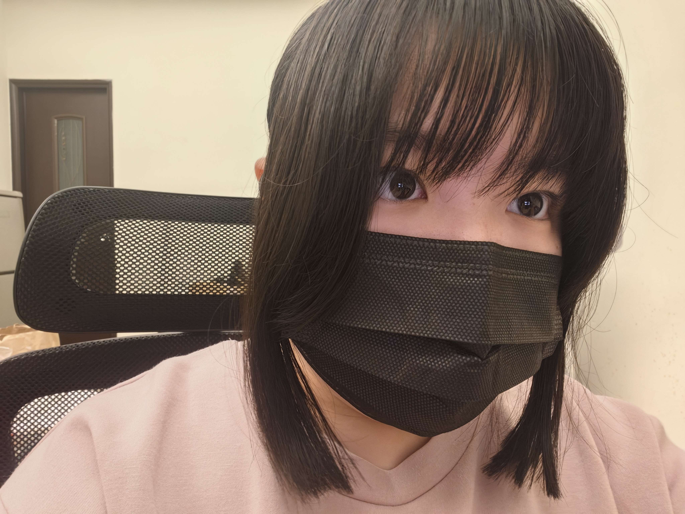
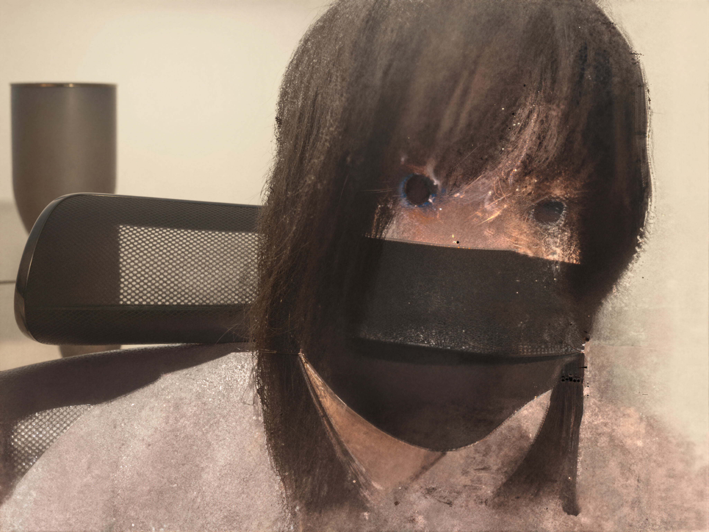
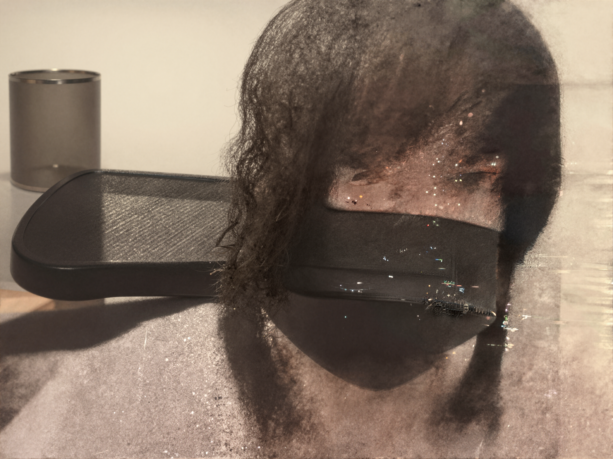
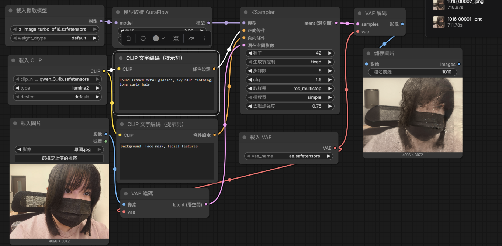
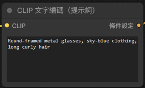
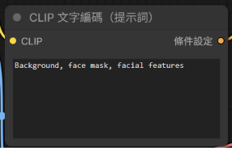

# comfyUI生成圖片
1. 原圖

2. 生成的圖(兩次生成結果)
- 第一次生成結果 

- 第二次生成結果 

3. 完整工作流截圖

4. 使用的正反提示詞
- 正提示詞：Round-framed metal glasses, sky-blue clothing, long curly hair 

- 反提示詞：Background, face mask, facial features 

5. 個人心得 第一次生成的圖片變的很模糊，且不知道為甚麼藍色出現在眼睛上。在調整了去雜訊度後生成了第二次結果，這次更模糊了，但是隱約可以看到想要的捲髮效果出現了。我覺得應該還要再嘗試調整各項參數值，或許就能夠生成出最初希望的樣子。